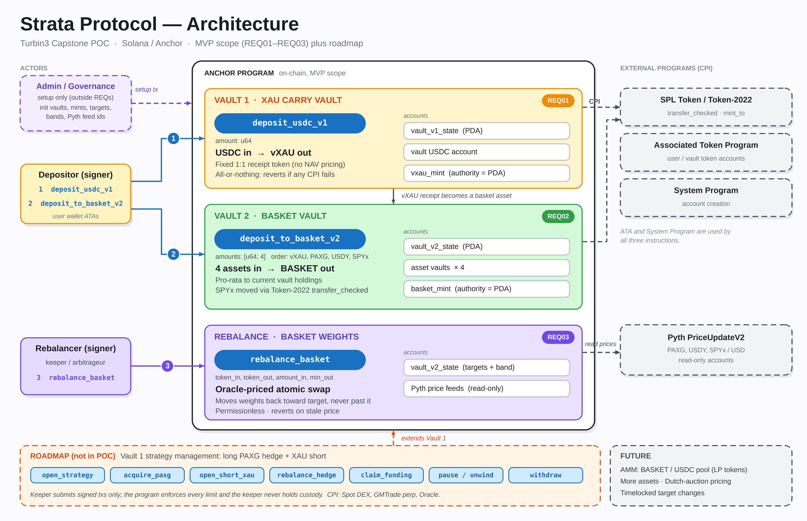
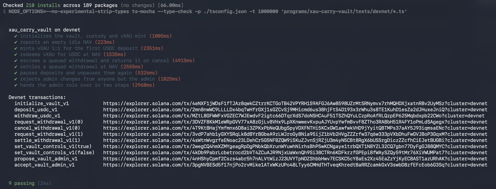
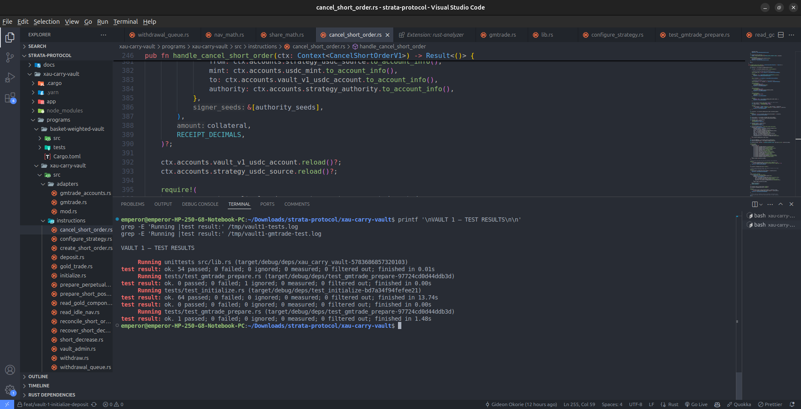
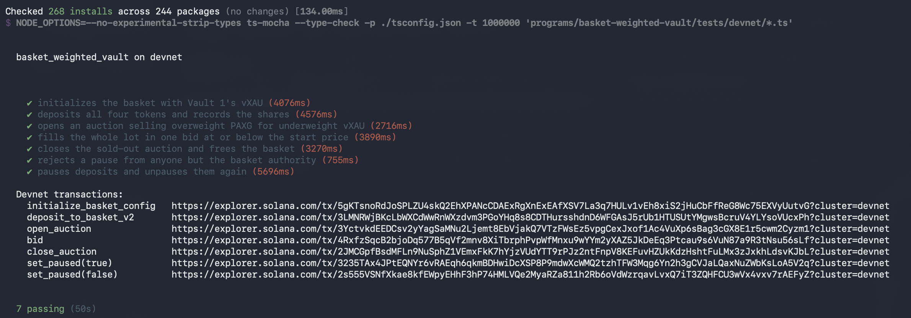
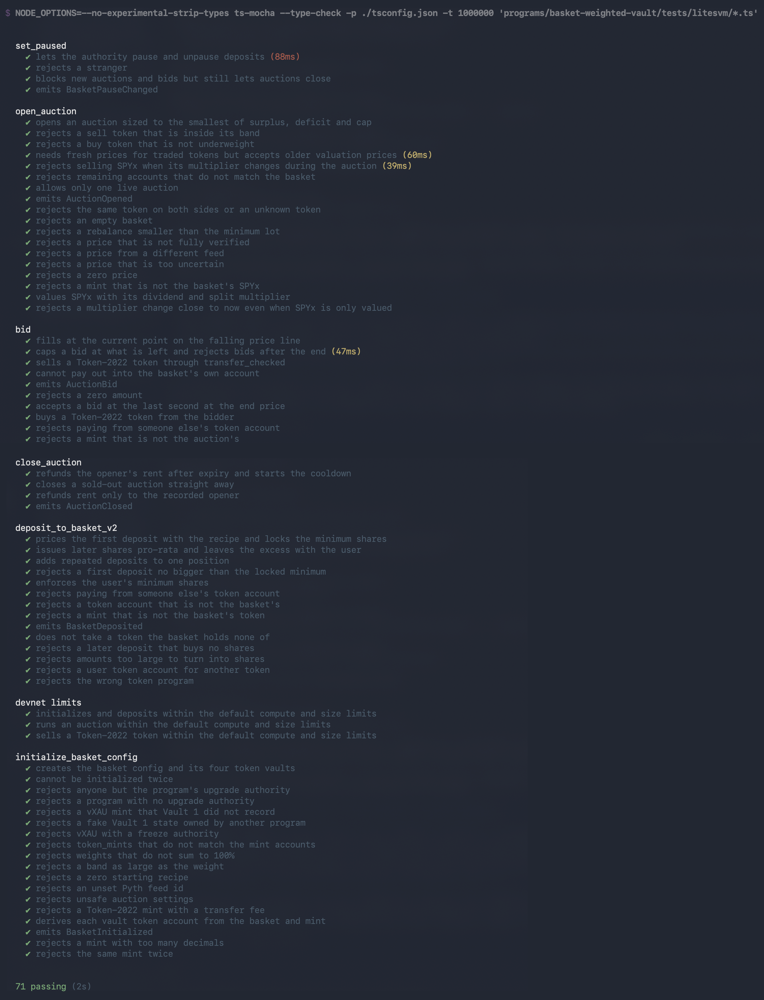

# Strata Protocol

Strata is a Solana dual-vault protocol: a USDC gold carry vault, and a shared RWA basket with permissionless rebalancing.

This repository is the shared workspace for Team 13: Ankit Tiwari, Viraz, and Gideon.
The project is in development and has not been independently audited.

- **Vault 1 - XAU Carry Vault:** users deposit USDC and receive vXAU, a NAV-priced share of a strategy that holds tokenized gold alongside a short XAU perpetual hedge.
- **Vault 2 - Basket Weighted Vault:** users deposit vXAU, PAXG, USDY and SPYx in the basket's current proportions and receive shares, referred to as STRAT-INDEX.
  When prices push a token outside its band, anyone can rebalance the basket through a Dutch auction.



Implementation decisions and clarifications should be recorded in `docs/`.

## Repository structure

Each vault is its own Anchor workspace, and each program's tests live beside it.

```text
strata-protocol/
  README.md
  docs/
    architecture-diagram.png
  xau-carry-vault/                    Vault 1 Anchor workspace
    Anchor.toml
    Cargo.toml
    programs/
      xau-carry-vault/
        README.md                     Vault 1 documentation
        docs/images/
        src/
        tests/                        Rust LiteSVM tests and fixtures
        tests/devnet/                 TypeScript tests against the devnet deployment
    package.json                      Devnet test scripts
    tests/fixtures/pyth/              Pyth fixtures written by the scripts
    scripts/                          Pyth and GMTrade verification scripts
    vendor/gmtrade/                   Vendored GMTrade crates
  basket-weighted-vault/              Vault 2 Anchor workspace
    Anchor.toml
    Cargo.toml
    package.json
    programs/
      basket-weighted-vault/
        src/
        tests/litesvm/                TypeScript LiteSVM tests
        tests/devnet/                 TypeScript tests against the devnet deployment
```

Vault 2 depends on the Vault 1 crate (`../../../xau-carry-vault/programs/xau-carry-vault`, `cpi` feature) for Vault 1's program ID, vXAU seed and `VaultV1State` type.

## Team ownership

- Gideon: Vault 1 initialization, USDC deposits, and vXAU receipt issuance.
- Ankit: Vault 2 initialization, basket deposits.
- Viraz: Rebalancing and Auction Mechanism
- Shared review: the vXAU mint, decimals, token program, POC valuation, and cross-program integration tests.

## Devnet deployment

Both programs are deployed to Solana devnet.

| Program | Devnet program ID |
| --- | --- |
| Vault 1 - `xau_carry_vault` | [`G1FuDAbgPsVw95XnEjT68nqpswUtvxFBtxz4mdTJKsye`](https://explorer.solana.com/address/G1FuDAbgPsVw95XnEjT68nqpswUtvxFBtxz4mdTJKsye?cluster=devnet) |
| Vault 2 - `basket_weighted_vault` | [`DN3quR3M9kWnw1v9bmY93vdWu3ciRPgb72HPKpQoTDC2`](https://explorer.solana.com/address/DN3quR3M9kWnw1v9bmY93vdWu3ciRPgb72HPKpQoTDC2?cluster=devnet) |

Upgrade authority for both: `8wKdNyBMxGJjWcj4bREsXgCi8kpww9jj1ggSVxmj8yKQ`.

## Capstone scope

| Requirement | Instruction | Purpose |
| --- | --- | --- |
| REQ01 | `deposit_usdc_v1(amount, min_shares_out)` | Transfer USDC into Vault 1 and mint NAV-priced vXAU. |
| REQ02 | `deposit_to_basket_v2(max_amounts, min_shares_out)` | Transfer the four basket components pro-rata and record shares in the user's position. |
| REQ03 | `open_auction(sell_index, buy_index)`, `bid(sell_amount, max_buy_amount)`, `close_auction()` | Rebalance by Dutch auction: sell an overweight component for an underweight one, subject to oracle and portfolio checks. |

`initialize_vault_v1` and `initialize_basket_config` are setup prerequisites, each restricted to its program's upgrade authority.
Each instruction's token transfers and minting occur atomically through CPIs.

Vault state accounts belong to the relevant Strata program.
Token accounts and mints belong to the SPL Token or Token-2022 program, with Strata PDAs as their authorities where appropriate.

# Vault 1 - XAU Carry Vault

XAU Carry Vault is a USDC-denominated strategy vault that combines tokenized gold exposure with a short XAU perpetual hedge.

Users deposit USDC and receive **vXAU**, a six-decimal share token representing proportional ownership of the vault’s net assets. The strategy buys tokenized gold through Jupiter and manages its perpetual hedge through GMTrade.

The vault accounts for gold holdings, perpetual position equity, funding, borrowing costs, and execution fees. Deposits and redemptions use net asset value (NAV), allowing strategy gains and losses to flow into the value of each vXAU share.

## Strategy lifecycle

1. Users deposit USDC and receive vXAU shares.
2. The strategy administrator buys PAXG through Jupiter.
3. The administrator submits a short XAU perpetual order through GMTrade.
4. After execution, reconciliation authenticates the resulting order and position against a persisted pre-order baseline.
5. Full NAV determines deposit and redemption pricing.
6. To release liquidity, the administrator reduces or closes the hedge and sells gold.
7. Returned USDC is swept into vault custody and becomes available for withdrawals.

The strategy targets net carry from holding gold alongside an offsetting perpetual position. Returns depend on funding, borrowing costs, trading fees, execution prices, and hedge performance; they are not guaranteed.

## Shares and accounting

USDC and vXAU use six decimals.

For an empty vault, shares bootstrap at a 1:1 ratio. Once shares are outstanding, deposits and redemptions use proportional NAV pricing:

```text
shares minted = floor(deposit amount × outstanding shares / NAV)

assets redeemed = floor(shares redeemed × NAV / outstanding shares)
```

For example, if the vault has 120 USDC of NAV and 100 vXAU outstanding:

- Depositing 12 USDC mints 10 vXAU.
- Redeeming 10 vXAU returns 12 USDC, subject to available withdrawal liquidity.

Minimum-output parameters protect users against receiving fewer shares or assets than expected.

`total_deposited` records cumulative successful deposits. It does not represent current NAV, available cash, outstanding share supply, or strategy profit.

## Net asset value

Full NAV combines:

- USDC held in vault custody.
- USDC held by the strategy authority.
- Eligible collateral held in pending-order escrow.
- Realizable tokenized-gold value.
- Signed perpetual position equity, including applicable funding, borrowing costs, and projected closing costs.

Accounting distinguishes asset transfers from profit, avoids double-counting collateral, and applies conservative rounding and price-confidence bounds.

NAV and withdrawal liquidity are separate. Gold and perpetual equity contribute to share value, but immediate withdrawals require sufficient USDC in vault custody.

## Instructions

### Initialization and administration

| Instruction | Purpose |
| --- | --- |
| `initialize_vault_v1` | Initializes vault state, deposit custody, and the vXAU mint. Restricted to the program’s current upgrade authority. |
| `configure_strategy_v1` | Configures the strategy’s GMTrade accounts. |
| `set_vault_controls_v1` | Updates pause controls and order limits. |
| `set_strategy_execution_v1` | Enables or disables new strategy deployment. |
| `propose_vault_admin_v1` | Proposes a new vault administrator. |
| `accept_vault_admin_v1` | Completes administrator transfer through acceptance by the proposed administrator. |
| `recover_unowned_custody_v1` | Recovers eligible unowned bootstrap custody without taking assets backing outstanding receipts. |

Initialization creates these PDAs:

```text
Vault state:     ["vault_v1", deposit_mint]
Deposit custody: ["token_vault", vault_state]
vXAU mint:       ["vxau_mint", vault_state]
```

The deposit mint must have six decimals. Initialization does not establish that it is an official USDC mint; deployment configuration must select the intended mint. Strategy execution additionally validates its supported mint identities.

### Deposits and withdrawals

| Instruction | Purpose |
| --- | --- |
| `deposit_usdc_v1(amount, min_shares_out)` | Transfers deposit tokens into custody and mints NAV-priced vXAU shares. |
| `withdraw_usdc_v1(amount, min_assets_out)` | Burns the specified number of vXAU shares and returns NAV-priced deposit tokens. |
| `request_withdrawal_v1(nonce, shares, min_assets_out)` | Escrows shares for deferred redemption. |
| `settle_withdrawal_v1` | Permissionlessly settles an eligible request using current NAV and available custody liquidity. |
| `cancel_withdrawal_v1` | Returns escrowed shares to the request owner. |

Queued shares remain outstanding until settlement burns them. Requests are priced at settlement rather than locking an asset value when submitted.

The final redemption requires strategy assets and pending orders to be fully unwound.

### Gold trading and custody

| Instruction | Purpose |
| --- | --- |
| `buy_gold_v1` | Exchanges vault USDC for PAXG through a validated Jupiter shared-accounts route. |
| `sell_gold_v1` | Exchanges PAXG back into USDC through a validated route. |
| `sweep_strategy_usdc_v1` | Permissionlessly returns strategy USDC to canonical vault custody. |

Gold trades validate custody accounts, mint identities, route accounts, exact input amounts, and minimum net output. Supported Token-2022 transfer fees are measured through actual received balances.

Gold purchases require strategy deployment to be enabled and unpaused. Gold sales remain available as a recovery operation when deployment is disabled or paused.

### Perpetual hedging and reconciliation

| Instruction | Purpose |
| --- | --- |
| `prepare_perpetual_user_v1` | Initializes or reuses the strategy’s GMTrade user account. |
| `prepare_short_position_v1` | Initializes or reuses the canonical short position. |
| `create_short_order_v1` | Persists a pre-order baseline and submits a short-increase order. |
| `reconcile_short_order_v1` | Authenticates completed execution and clears local pending-order records. |
| `cancel_short_order_v1` | Cancels or cleans up an eligible increase order and recovers collateral. |
| `create_short_decrease_v1` | Submits a partial reduction or full unwind with a persisted baseline and minimum output. |
| `reconcile_short_decrease_v1` | Authenticates completed reduction, recovers proceeds, and sweeps returned USDC into custody. |
| `cancel_short_decrease_v1` | Cancels or cleans up an eligible decrease order. |
| `accept_full_close_decrease_v1` | Allows the administrator to explicitly accept a protocol-forced full close, subject to reconciliation checks. |

Reconciliation checks authenticated GMTrade accounts, order identity, nonce, execution metadata, and position changes. A missing or cancelled order does not prove successful execution.

### Valuation

| Instruction | Purpose |
| --- | --- |
| `read_idle_nav_v1` | Reports custody-based NAV for an unconfigured strategy. |
| `read_gold_component_v1` | Reports authenticated tokenized-gold valuation. |
| `read_full_nav_v1` | Reports strategy-wide NAV, outstanding shares, and available custody liquidity. |

## Security controls

- PDA, owner, mint, authority, and external-account identity checks.
- Authenticated price updates with freshness and confidence limits.
- Checked arithmetic and conservative valuation rounding.
- User-defined minimum share and redemption outputs.
- Administrator-controlled deployment and order limits.
- Persisted execution baselines and replay-resistant reconciliation.
- Custody-liquidity checks before redemption.
- Recovery operations for disabling deployment, reducing exposure, and returning strategy cash.
- Atomic rollback if a transfer, CPI, validation, or accounting check fails.

Transaction fees remain payable when a transaction fails.

## Validation

From the repository root:

```bash
cd xau-carry-vault
rm -f target/deploy/xau_carry_vault.so
anchor build --arch v0
cargo test -p xau-carry-vault
cargo test -p xau-carry-vault --test test_gmtrade_prepare -- --ignored
```

The tests use LiteSVM 0.10, which loads only SBPF v0 programs, so the program must be built with `--arch v0`.
A plain `anchor build` produces SBPF v3, and a later `anchor build --arch v0` keeps that v3 file when no source changed, so the `rm` forces a fresh v0 build.
Without it, all 64 integration tests fail with `InvalidAccountData`.
Do not use `anchor test` here; it tries to start a local validator the LiteSVM tests do not need.

### Vault 1 devnet tests

A separate suite runs against the Vault 1 program deployed on devnet.
From the repository root:

```bash
cd xau-carry-vault
bun install
bun run test:devnet
```

By default the suites use the public devnet RPC, which rate-limits bursts and can print a harmless `ws error: Unexpected server response: 429`.
To avoid it, point `ANCHOR_PROVIDER_URL` at a dedicated devnet RPC such as [Helius](https://www.helius.dev) (free tier):

```bash
export ANCHOR_PROVIDER_URL="https://devnet.helius-rpc.com/?api-key=YOUR_KEY"
bun run test:devnet
```

Keep the API key in your shell environment only and never commit it.

It uses the wallet at `~/.config/solana/id.json` (or `ANCHOR_WALLET`), which must be the program's upgrade authority because `initialize_vault_v1` requires it.
Each run creates a fresh mock USDC mint, so it initializes a new vault every time, then:

1. Initializes the vault, its USDC custody and the vXAU mint.
2. Reads the idle NAV of the empty vault.
3. Deposits 700 USDC and checks that 700 vXAU are minted 1:1.
4. Redeems 100 vXAU for 100 USDC at NAV.
5. Queues a withdrawal and cancels it, checking the shares return from escrow.
6. Queues and settles a withdrawal, checking the USDC paid out and the NAV afterwards.
7. Pauses deposits, checks a deposit is rejected, and unpauses.
8. Rejects an admin change from a stranger, then hands the admin role over in two steps.

The strategy instructions (Jupiter gold trades and GMTrade perpetual orders) are not run on devnet, because Jupiter and GMTrade are mainnet-only.
The suite prints a devnet Explorer link for every Vault 1 transaction.

#### Devnet test results



The captured GMTrade fixtures in `programs/xau-carry-vault/tests/fixtures/gmtrade/` are gitignored and must exist before the tests compile.
To fetch them from mainnet with the Solana CLI:

```bash
cd xau-carry-vault/programs/xau-carry-vault/tests/fixtures/gmtrade
solana program dump -um Gmso1uvJnLbawvw7yezdfCDcPydwW2s2iqG3w6MDucLo gmtrade.so
solana account -um CTDLvGGXnoxvqLyTpGzdGLg9pD6JexKxKXSV8tqqo8bN --output json -o store.json
solana account -um 59uFARJWg7B8wcEuXzvkafiT4DuKemdNCN5bshDbwun9 --output json -o market.json
solana account -um 59uFARJWg7B8wcEuXzvkafiT4DuKemdNCN5bshDbwun9 -o xau_market.bin
solana account -um Xauxf2VJhbue14FGbp3W8XwfQSECHYpiPMNMWSCwjSR -o xau_index_mint.bin
solana account -um 5GgRAEmv8ZxF2PR5hY72Qs5x1bnQ6UK2RbTPoqJ3wSwW -o paxg_mint.bin
```

The verified suite contains **119 passing tests**:

- 54 unit tests.
- 64 LiteSVM integration tests.
- One explicitly enabled GMTrade snapshot test.

Coverage includes initialization, deposits, redemptions, withdrawal queues, NAV pricing, account authentication, position valuation, execution reconciliation, gold trading, transfer fees, recovery, and transaction rollback.

Tests use controlled price updates, a test-only swap router, captured GMTrade fixtures, and controlled execution-state transitions. The router fixture is exclusively for testing.

### Test results

The Vault 1 test suite passed all 119 tests: 54 unit tests,
64 integration tests, and one explicitly enabled GMTrade snapshot test.




### Live integration blocker

The gold-feed access options evaluated required paid access that had
not yet been arranged. Contract validation therefore used controlled
authenticated price updates and captured GMTrade fixtures.

Live oracle delivery, production Jupiter routing, actual GMTrade
execution, and keeper transaction sequencing still require end-to-end
verification. These local test results do not establish live deployment
readiness.

## Integration with Vault 2

Vault 2 must derive the vXAU mint from the configured Vault 1 state and enforce that mint identity in its account constraints.

vXAU represents proportional ownership of Vault 1’s net assets. It is not a fixed-value USDC receipt or a promise of one unit of physical gold.

Vault 2 can accept vXAU as a basket component while Vault 1 manages its underlying strategy and redemption lifecycle.

## Audit status

This implementation has not been independently audited.

# Vault 2 - Basket Weighted Vault

Basket Weighted Vault holds a fixed-weight basket of four tokens: vXAU, PAXG, USDY and SPYx.
Users deposit all four tokens in the basket's current proportions and receive shares recorded in a `UserPosition` account.
No basket token is minted.

When prices move the basket away from its target weights, anyone can open a Dutch auction that sells the overweight token for the underweight one.
Bidders buy at a price that falls over time from slightly above the oracle rate to slightly below it.
The basket never trades through an AMM or an external router; bidders bring the liquidity.

## Tokens and weights

| Index | Token | Default weight | Token program | Price source |
| --- | --- | --- | --- | --- |
| 0 | vXAU (Vault 1 receipt) | 40% | SPL Token | `Fixed` (for example $1) |
| 1 | PAXG (tokenized gold) | 20% | SPL Token | Pyth `Crypto.PAXG/USD` |
| 2 | USDY (tokenized treasuries) | 25% | SPL Token | Pyth `Crypto.USDY/USD` |
| 3 | SPYx (tokenized S&P 500) | 15% | Token-2022 with Scaled UI Amount | Pyth `Crypto.SPYX/USD` x mint multiplier |

Weights and price sources are set once at initialization and stored in basis points (they must sum to 10,000).
The order of tokens is fixed: index 0 must be the vXAU mint recorded by Vault 1.

SPYx uses the Token-2022 Scaled UI Amount extension to reflect dividends and splits.
Its USD value is `raw balance x multiplier x price`, where the multiplier is read from the mint.

## Vault 2 accounts

```text
BasketConfig:  ["basket_config", vault]
Asset vault:   ["asset_vault", basket_config, mint]     one per token, owned by BasketConfig
Auction:       ["auction", basket_config, nonce (u64 LE)]
UserPosition:  ["position", basket_config, user]
```

| Account | Holds |
| --- | --- |
| `BasketConfig` | Authority, mints, weights, per-token `AssetConfig`, first-deposit recipe, total shares, `RebalanceConfig`, auction counter, active-auction flag, last auction end time, pause flag. |
| `AssetConfig` | The basket's token account, token program, decimals, price source, Scaled UI flag, drift band and maximum auction size for one token. |
| `RebalanceConfig` | Price freshness and confidence limits, auction start premium, maximum discount, duration, cooldown and minimum auction size. |
| `Auction` | One running auction: which tokens, how much is on offer, how much is left, how much was received, the price line and its times. |
| `UserPosition` | A user's shares in one basket, plus when the position was created and last topped up. |

The basket's token accounts are owned by the `BasketConfig` PDA, so only the program can move tokens out, and only through a bid.

## Vault 2 instructions

| Instruction | Signer | Purpose |
| --- | --- | --- |
| `initialize_basket_config(token_mints, weights, settings)` | Program upgrade authority | Creates the basket config and its four token accounts. |
| `deposit_to_basket_v2(max_amounts, min_shares_out)` | Any user | Deposits all four tokens pro-rata and adds shares to the user's position. |
| `open_auction(sell_index, buy_index)` | Anyone | Starts a Dutch auction selling an overweight token for an underweight one. |
| `bid(sell_amount, max_buy_amount)` | Anyone | Buys part or all of a live auction at the current price. |
| `close_auction()` | Anyone | Closes a sold-out or expired auction and refunds its rent to the opener. |
| `set_paused(paused)` | Basket authority | Turns the emergency stop on or off. |

### `initialize_basket_config`

Only the program's current upgrade authority can create a basket, which prevents someone else from creating it first with bad settings.
The instruction checks that:

- `token_mints` matches the mint accounts passed in.
  A mint passed twice fails because its token account address would already be taken.
- Token 0 is the vXAU mint recorded in Vault 1's `VaultV1State`, its mint authority is that Vault 1 state, and it has no freeze authority.
- Every mint has at most 18 decimals.
- No Token-2022 mint uses an unsupported extension (transfer fee, transfer hook, non-transferable, default account state, interest-bearing, confidential transfer fee).
- Weights sum to 10,000, every weight is above zero, and every drift band is smaller than its weight.
- Every first-deposit recipe amount is above zero, and every price source is set.
- Auction settings are within the safety caps below.

| Setting | Allowed range |
| --- | --- |
| `auction_duration_s` | 60 s to 1 day |
| `start_premium_bps` | at most 10% |
| `max_discount_bps` | at most 10% |
| `max_conf_bps` | above 0, at most 5% |
| `max_age_traded_s` | above 0, at most 300 s, and no more than `max_age_nav_s` |
| `max_age_nav_s` | at most 7 days |
| `min_lot_usd` | above 0, and no more than any token's `max_lot_usd` |

### `deposit_to_basket_v2`

Deposits are in-kind: the user sends all four tokens, never just one.
`max_amounts` is the most the user is willing to send of each token, and the program takes only what keeps the basket's proportions unchanged.

The first deposit uses the recipe `initial_units`, the raw amount of each token in one share:

```text
shares = min over tokens of floor(max_amount x 10^6 / initial_units)
amount = ceil(shares x initial_units / 10^6)
```

Later deposits use the basket's current balances:

```text
shares = min over tokens of floor(max_amount x total_shares / balance)
amount = ceil(shares x balance / total_shares)
```

Shares round down and amounts round up, so rounding always favors the basket.
A token the basket currently holds none of is skipped, and the user keeps it.
Any excess beyond the pro-rata amounts stays with the user.

The first deposit permanently locks 1,000 shares (`MIN_LOCKED_SHARES`) that no user owns.
This stops the first depositor from making one share so expensive that later deposits round to zero.

The instruction fails if the basket is paused, if the user would receive zero shares, or if they would receive fewer than `min_shares_out`.
After the transfers it checks that each basket balance rose by exactly the amount sent.

### `open_auction`

Anyone can open an auction; they pay the auction account's rent and get it back on close.
Only one auction runs at a time, and a cooldown applies after each one closes.

Remaining accounts, in order:

1. The basket's four token accounts.
2. The Pyth `PriceUpdateV2` account for each token with a `Pyth` price source (three by default).
3. The SPYx mint, for its multiplier.

The instruction values every holding in USD, then checks the two tokens:

- The sell token must be above its target weight plus its band.
- The buy token must be below its target weight.

The auction size is the smallest of the sell token's surplus over target, the buy token's deficit under target, and the sell token's `max_lot_usd`.
It must be at least `min_lot_usd`.

Prices for the two traded tokens must be at most `max_age_traded_s` old, while the other tokens may be up to `max_age_nav_s` old because they are only used to value the basket.
Every Pyth price must be fully verified, come from the configured feed, be positive, and have confidence within `max_conf_bps` of the price.

If SPYx is traded, its multiplier must not change from 15 minutes before now until 15 minutes after the auction ends.
If SPYx is only valued, it must not change within 15 minutes either side of now.

The price is quoted in buy-token units per sell-token unit (18 decimals):

```text
oracle rate = sell USD price / buy USD price, adjusted for decimals
start price = oracle rate x (1 + start_premium_bps)
end price   = oracle rate x (1 - max_discount_bps)
```

### `bid`

The price falls in a straight line from the start price at `start_ts` to the end price at `end_ts`:

```text
price = start - (start - end) x elapsed / duration
```

A bidder asks for up to `sell_amount` of the sell token and pays `ceil(fill x price)` of the buy token, never more than `max_buy_amount`.
Partial fills are allowed; the auction stays open until it sells out or expires.
Bids are accepted from `start_ts` through `end_ts` inclusive.

The bidder pays first, and the program checks the basket received the full amount before paying out from the basket's account.
The bidder's paying account must be owned by the bidder; the receiving account can be any account for the sell mint other than the basket's own.

Because the price starts above the oracle rate and falls, the first bidder to find it profitable wins, and the basket gives up at most `max_discount_bps`.

### `close_auction`

Anyone can close an auction once it has sold out or `end_ts` has passed.
Closing frees the basket for the next auction, starts the cooldown, and returns the rent to the original opener.

### `set_paused`

The basket authority can stop deposits, new auctions and bids.
`close_auction` stays available while paused, so a running auction can always be cleaned up.

## Vault 2 end-to-end flow

```text
admin       initialize_basket_config  ->  BasketConfig + 4 empty token accounts
user A      deposit_to_basket_v2      ->  recipe sets the first share price, 1,000 shares locked
user B      deposit_to_basket_v2      ->  pro-rata shares at the current mix
            ... prices move, PAXG rallies above 20% + band, vXAU falls below 40% ...
keeper      open_auction(PAXG, vXAU)  ->  Auction #0, sell PAXG, price falling
bidder(s)   bid                       ->  pay vXAU, receive PAXG
keeper      close_auction             ->  basket free again after the cooldown
```

## Vault 2 events

| Event | Emitted by |
| --- | --- |
| `BasketInitialized` | `initialize_basket_config` |
| `BasketDeposited` | `deposit_to_basket_v2` |
| `AuctionOpened` | `open_auction`; bidder bots listen for this |
| `AuctionBid` | `bid` |
| `AuctionClosed` | `close_auction` |
| `BasketPauseChanged` | `set_paused` |

## Vault 2 security controls

- Basket creation gated by the program's upgrade authority.
- vXAU identity proven from Vault 1's typed state, with the Vault 1 program ID taken from the Vault 1 crate.
- PDA, owner, mint, token program and token account checks on every account.
- Pyth verification level, feed id, staleness, confidence and sign checks.
- Scaled UI multiplier changes blocked across the whole auction window.
- Caps on premium, discount, confidence, staleness and duration.
- Exact balance checks after every transfer, so no fee or hook can skim.
- 256-bit intermediate math, checked arithmetic, and rounding in the basket's favor.
- Minimum-shares and maximum-payment limits chosen by the user.
- One auction at a time, with a cooldown.
- Emergency pause.

## Vault 2 on devnet

Vault 1 runs on devnet, so vXAU is real.
Paxos and Ondo publish no devnet PAXG or USDY, and SPYx has no devnet mint, so devnet uses mock mints for those three.
The mock SPYx is a Token-2022 mint with the Scaled UI Amount extension, like the real one.

On devnet the basket uses the program's `Fixed` price source instead of Pyth: vXAU $1, PAXG $4,250, USDY $1.15 and SPYx $772.
Posting fresh, fully verified Pyth prices needs a paid Hermes API key, and Pyth's sponsored devnet price accounts for these feeds are weeks stale or missing, so they fail the basket's freshness checks.
The program code is unchanged; with a Hermes key, a basket configured with the Pyth feeds below runs the same way.

| Feed | Pyth id |
| --- | --- |
| `Crypto.PAXG/USD` | `273717b49430906f4b0c230e99aa1007f83758e3199edbc887c0d06c3e332494` |
| `Crypto.USDY/USD` | `e393449f6aff8a4b6d3e1165a7c9ebec103685f3b41e60db4277b5b6d10e7326` |
| `Crypto.SPYX/USD` | `2817b78438c769357182c04346fddaad1178c82f4048828fe0997c3c64624e14` |

Every instruction fits devnet's default 200,000 compute unit limit and 1,232-byte transaction limit; the test suite checks this.

## Vault 2 validation

Tests run against the built program in LiteSVM, written in TypeScript with ts-mocha.
From `basket-weighted-vault/`:

```bash
bun install
bun run test:basket      # anchor build, then the LiteSVM suite (anchor test also works)
bun run test:devnet      # suite against the basket deployed on devnet
bun run lint:basket      # Prettier check (lint:basket:fix to format)
```

```text
programs/basket-weighted-vault/tests/litesvm/
  helpers/litesvm-provider.ts   Anchor provider backed by LiteSVM
  helpers/basket.ts             TestBasket fixture, price/clock helpers, expected-math helpers
  initialize.ts                 initialize_basket_config
  deposit.ts                    deposit_to_basket_v2
  auction.ts                    open_auction, bid, close_auction
  admin.ts                      set_paused
  devnet-limits.ts              compute unit and transaction size limits
programs/basket-weighted-vault/tests/devnet/
  helpers/devnet.ts             Devnet provider, Vault 1 and basket clients
  devnet.ts                     Vault 1 and basket flow against the deployed programs
```

The suite has 71 tests covering every reachable error and every event.
Pyth price accounts, the Scaled UI multiplier, Vault 1's state and the clock are written directly into LiteSVM.

### Devnet tests

A second suite runs against the basket program deployed on devnet.
From the repository root:

```bash
cd basket-weighted-vault
bun install
bun run test:devnet
```

By default the suites use the public devnet RPC, which rate-limits bursts and can print a harmless `ws error: Unexpected server response: 429`.
To avoid it, point `ANCHOR_PROVIDER_URL` at a dedicated devnet RPC such as [Helius](https://www.helius.dev) (free tier):

```bash
export ANCHOR_PROVIDER_URL="https://devnet.helius-rpc.com/?api-key=YOUR_KEY"
bun run test:devnet
```

Keep the API key in your shell environment only and never commit it.

It uses the wallet at `~/.config/solana/id.json` (or `ANCHOR_WALLET`), which must be the upgrade authority of both programs, because setup initializes a Vault 1 and the tests initialize a basket.

As setup, each run initializes a fresh Vault 1 on a mock USDC mint and deposits USDC to mint real vXAU, then creates mock PAXG, USDY and SPYx (Token-2022, Scaled UI Amount).
The tests then:

1. Initialize a basket with that vXAU and the three mock tokens.
2. Deposit all four tokens and check the recorded shares and basket balances.
3. Open an auction selling overweight PAXG for underweight vXAU.
4. Fill the whole lot in one bid and check both basket balances.
5. Close the sold-out auction and check the basket is free again.
6. Reject a pause from anyone but the basket authority.
7. Pause, check a deposit is rejected, and unpause.

The suite prints a devnet Explorer link for every basket transaction.

#### Devnet test results



### Test results

The Vault 2 test suite passed all 71 tests across `initialize_basket_config`, `deposit_to_basket_v2`, `open_auction`, `bid`, `close_auction`, `set_paused` and the devnet limit checks.



## Vault 2 limitations

- There are no withdrawals yet; shares can only be recorded.
- vXAU is priced with a fixed price source; it does not yet read Vault 1's NAV.
- One auction runs at a time, and each trades one pair of tokens.
- The token list is fixed at four.

# How the vaults connect

vXAU is token 0 in the basket.
When a basket is created, Vault 2 reads Vault 1's `VaultV1State` and requires that the vXAU mint is the one recorded there, that Vault 1 is its mint authority, and that it has no freeze authority.
Nothing else in Vault 2 calls Vault 1.

vXAU represents proportional ownership of Vault 1's net assets.
It is not a fixed-value USDC receipt or a promise of one unit of physical gold.
Vault 2 accepts vXAU as a basket component while Vault 1 manages its underlying strategy and redemption lifecycle.
